<a id="top"></a>

# LLM-as-a-Judge & Advanced Evaluation

**Lecture 15 · Module 8 (Agentic AI Systems) · Visual study notes**

Source notebook: [`L14_LLM-as-a-Judge & Advanced Evaluation.ipynb`](./L14_LLM-as-a-Judge%20%26%20Advanced%20Evaluation.ipynb)
— 98 cells, 10 sections, 5 quizzes. A ReAct math agent is built, then measured five different
ways, and the five answers disagree.

The lecture's real subject is not the agent. It is **how much you should trust a number** —
and the recorded run happens to contain two bugs that make that question concrete.
[§6](#6) is the section to read if you read only one.

---

## How to read this

| Marker | Meaning |
|---|---|
| *(unmarked)* | **From the notebook** — concepts, code, numbers and outputs exactly as they ran |
| `> **⊕ Engineering context**` | **Added by me** — production material the notebook did not cover |
| `> **⚠ Bug in the run**` | Something the recorded output shows that the prose does not acknowledge |

Diagrams carrying the purple `EXTENSION — beyond notebook` badge are added context, not class
material. Cell numbers are 0-indexed against the notebook **as committed** — cell 0 is the
Open-in-Colab badge.

Every number below is re-derived from the notebook's saved outputs by
[`scripts/verify_llm_judge_results.py`](../../scripts/verify_llm_judge_results.py). Run it — it
prints `35/35 checks passed`, or names the figure that moved.

---

## Contents

| Part | What it covers | How it is taught |
|---|---|---|
| [0](#0) | Why each eval technique exists | Forced-move chain |
| [1](#1) | The 5-example fallacy | Why-layer |
| [2](#2) | The evaluation pyramid | Layered map |
| [3](#3) | The agent and the golden set | Setup |
| [4](#4) | Exact match, then symbolic match | Measured evidence |
| [5](#5) | LLM-as-a-Judge — the mental model | Anatomy |
| [6](#6) | **The scoreboard, and two silent bugs** | Evidence + audit |
| [7](#7) | Cohen's kappa, worked | Derivation |
| [8](#8) | Ensembles, escalation and disagreement | Mechanism |
| [9](#9) | Traces: whether vs why | Failure analysis |
| [10](#10) | DeepEval, CI gates and custom metrics | Tooling |
| [11](#11) | A judge is a classifier — correct its number | ⊕ Extension |
| [12](#12) | Error bars, position bias, building a judge | ⊕ Extension |
| [13](#13) | Production eval architecture | ⊕ Extension |
| [14](#14) | Which method? · the one mental model | Decision guide |
| [Q](#interview) | Interview bank — 5 tiers, 24 questions | Q → testing → reasoning → answer |
| [R](#recall) | Explain It Yourself · One-Page Revision | Active recall |

---

<a id="0"></a>

## 0 · Every eval step is forced by a failure

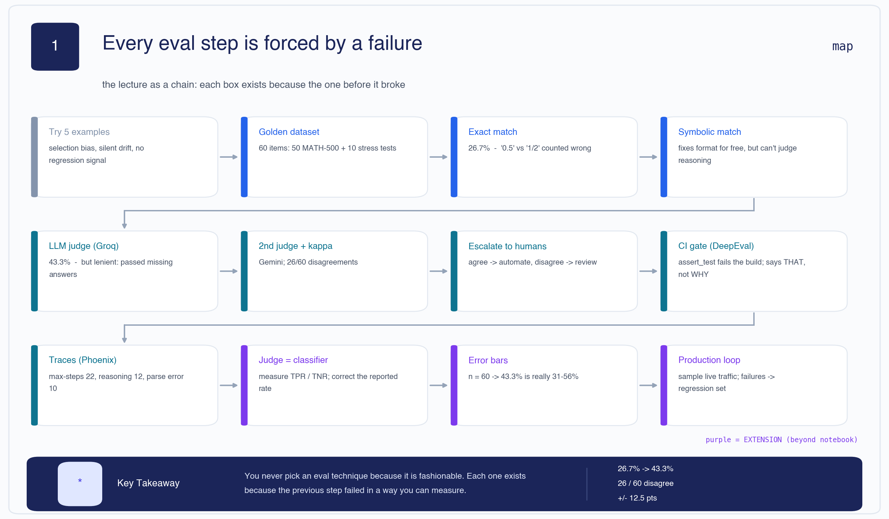

Nothing in this lecture is chosen because it is fashionable. Each technique exists because the one
before it broke in a way you can measure:

```text
Try 5 examples
      │  selection bias, silent drift, no regression signal
      ▼
Build a golden dataset  (60 items)
      │  ... but how do you mark it?
      ▼
Exact match                       26.7%
      │  "0.5" vs "1/2" counted wrong
      ▼
Symbolic match                    26.7%   ← fixed formatting, changed nothing
      │  still cannot judge reasoning
      ▼
LLM judge                         43.3%   ← but it passed answers that didn't exist
      │  one judge is one opinion
      ▼
Second judge + kappa              26/60 disagreements, kappa undefined
      │  judges disagree, and somebody must decide
      ▼
Escalate to humans  →  CI gate  →  traces  →  error bars  →  production loop
```

> 🧠 **Mental Model** — **A metric is a ruler, and rulers have errors too.** Every step above adds
> a ruler because the previous ruler was measuring the wrong thing — and the last few steps exist
> to measure the *rulers*.

[🔝 Back to top](#top)

---

<a id="1"></a>

## 1 · The evaluation crisis

The notebook opens (cell 11) with the **5-example fallacy**: you try your agent on five prompts,
it looks good, you ship. Three problems follow immediately.

| Layer | |
|---|---|
| **Problem** | You need to know whether your agent works — not whether it worked on the five examples you happened to try. |
| **Naive approach** | Eyeball a handful of outputs after each prompt change. |
| **Limitation** | **Selection bias** (you picked the examples), **silent drift** (a model or prompt change degrades something you never look at), and **no regression signal** (nothing fails loudly when you break it). |
| **Solution** | A fixed golden dataset, scored by an automated metric, run on every change. |
| **Trade-off** | Now the metric itself can be wrong — and a wrong metric is worse than no metric, because it is trusted. |

**Why traditional software testing does not transfer.** A unit test is deterministic: same input,
same output, exact comparison. An agent is stochastic, its output is free text, and "correct" has
degrees. `assertEqual` cannot express "the reasoning is sound but the arithmetic slipped".

> 🧠 **Remember**
> - Five examples give you an anecdote, not a measurement.
> - The three failure modes to name in an interview: selection bias, silent drift, no regression signal.
> - Replacing eyeballing with a metric moves the risk; it does not remove it.

[🔝 Back to top](#top)

---

<a id="2"></a>

## 2 · The evaluation pyramid

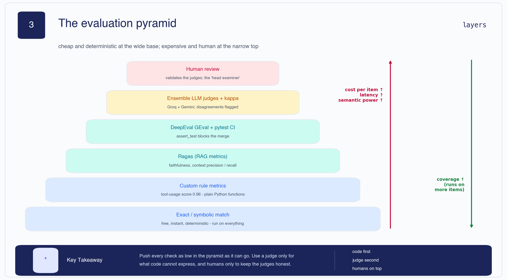

The organising idea of the whole lecture. Cost, latency and semantic power rise as you climb;
coverage falls.

| Layer | What it is | Cost |
|---|---|---|
| **Exact / symbolic match** | free, instant, deterministic — run on everything | none |
| **Custom rule metrics** | plain Python functions (the tool-usage score, [§10](#10)) | none |
| **Ragas** | RAG-specific metrics — faithfulness, context precision/recall | LM calls |
| **DeepEval GEval + pytest** | `assert_test` blocks the merge | LM calls |
| **Ensemble LLM judges + kappa** | two judges, disagreements flagged | 2× LM calls |
| **Human review** | validates the judges — the "head examiner" | expensive |

> 🧠 **Mental Model** — **Push every check as low in the pyramid as it can go.** Use a judge only
> for what code cannot express, and humans only to keep the judges honest.

[🔝 Back to top](#top)

---

<a id="3"></a>

## 3 · The agent and the golden set

**The agent under test** (cells 12–23) is a **ReAct** loop — Reason, Act, Observe — with one tool, a
calculator. The loop prompts the model for a thought and an action, executes the action, feeds the
observation back, and repeats until the model emits a final answer or hits a step cap.

**The golden dataset** (cells 34–41) is 60 items:

| Source | Count | Purpose |
|---|---|---|
| MATH-500 sample | 50 | stratified across 7 subjects and 5 difficulty levels |
| Hand-written stress tests | 10 | deliberately awkward cases |
| **Total** | **60** | |

Stratification matters here for the same reason it matters anywhere: if you sample
by convenience you measure the convenient subset. Note the size, though — 60 items is small, and
[§12](#12) shows exactly how small.

> 🧠 **Remember**
> - ReAct = Reason → Act → Observe, looped, with a step cap.
> - A golden set is fixed, stratified and version-controlled. It is the thing you regress against.
> - 60 items is a classroom budget, not a production one.

[🔝 Back to top](#top)

---

<a id="4"></a>

## 4 · Exact match, then symbolic match

**Exact match** (cell 43) is the naive metric: string-compare the prediction with the gold answer.
Its weakness is obvious and the notebook names it in cell 52 — `0.5` and `1/2` are the same number
and different strings.

So the notebook adds **symbolic matching**: normalise with SymPy so mathematically equivalent forms
compare equal. The result (cell 50):

```text
Exact-match accuracy:      26.7%
Symbolic-match accuracy:   26.7%   (deterministic, equivalence-aware)
Gap (symbolic - exact):    +0.0 points
```

**The upgrade bought exactly nothing.** Both are 16/60.

That is not a failure of symbolic matching — it is a finding about *this run*. The same cell prints
why:

```text
Stopped reason distribution:
Counter({'final_answer': 28, 'max_steps': 22, 'parse_error': 10})
```

**Only 28 of 60 runs produced an answer at all.** 22 hit the step cap, 10 failed to parse. When a
third of your predictions are `None`, equivalence-aware comparison has nothing to be equivalent
*to*. Formatting was never the bottleneck.

Split by source:

| Slice | Symbolic accuracy |
|---|---|
| MATH-500 sample | 11/50 = **22.0%** |
| Stress tests | 5/10 = **50.0%** |

> 🧠 **Mental Model** — **Fix the metric only after you have checked that the metric is the
> problem.** The gap of +0.0 is the cheapest possible evidence that it wasn't.

> 🧠 **Remember**
> - Exact 16/60 = 26.7%. Symbolic 16/60 = 26.7%. Gap **+0.0**.
> - 28 final answers, 22 max-steps, 10 parse errors.
> - A metric upgrade that moves nothing is still information.

[🔝 Back to top](#top)

---

<a id="5"></a>

## 5 · LLM-as-a-Judge — the mental model

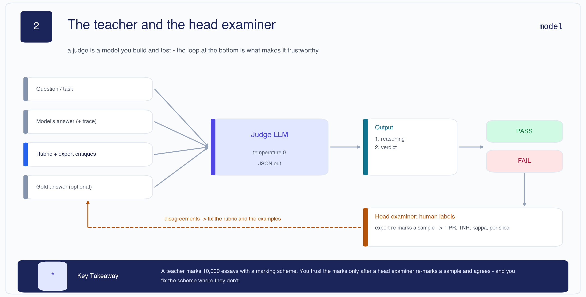

> 🧠 **Mental Model** — **The teacher and the head examiner.** A teacher marks 10,000 essays with a
> marking scheme. You trust the marks only after a head examiner re-marks a sample and agrees — and
> you fix the scheme where they don't. The judge is the teacher. Human review is the head examiner.
> Without the second half, you have marks nobody has checked.

**The anatomy.** Into the judge go: the question, the model's answer (and optionally its trace), a
rubric with expert critiques, and optionally a gold answer. Out comes **reasoning first, then a
verdict**. That ordering is deliberate — asking for the verdict first and the justification second
produces post-hoc rationalisation.

Two settings that matter: **temperature 0** (a judge should be reproducible) and **structured
output** (JSON), so the verdict can be parsed rather than regexed out of prose.

The single-judge setup in this notebook (cell 55 onward) is **Groq Llama-3.3-70B**, reference-guided:
it sees the gold answer and is asked whether the student's answer is equivalent.

```text
Exact-match accuracy:      26.7%
Groq-judge accuracy:       43.3%
Gap (judge - exact match): +16.7 points

Disagreements between exact-match and Groq judge: 14/60
```

A +16.7-point jump. That is the number the lecture is built to interrogate — and [§6](#6) shows that
part of it is not real.

[🔝 Back to top](#top)

---

<a id="6"></a>

## 6 · The scoreboard, and two silent bugs

### 6a · One agent, five accuracy numbers

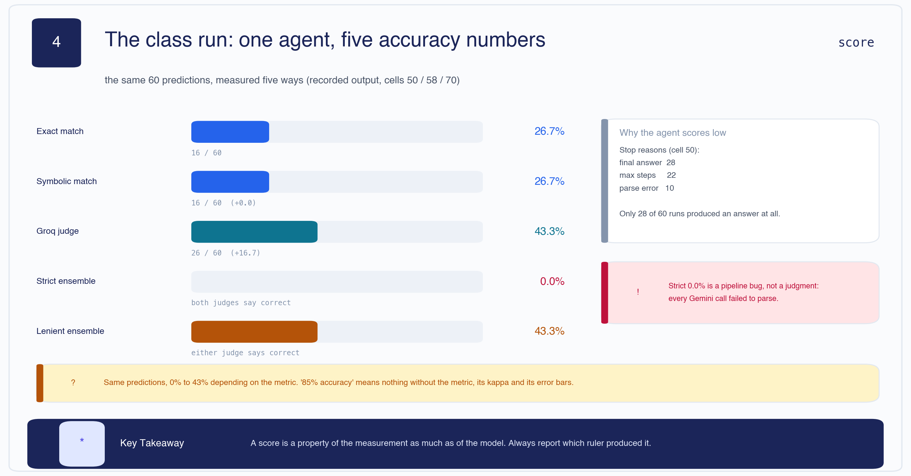

Same 60 predictions. Five rulers. Five answers:

| Metric | Score | Count |
|---|---|---|
| Exact match | 26.7% | 16/60 |
| Symbolic match | 26.7% | 16/60 |
| Groq judge | **43.3%** | 26/60 |
| Strict ensemble (both judges correct) | **0.0%** | 0/60 |
| Lenient ensemble (either judge correct) | 43.3% | 26/60 |

**0% to 43% depending on which ruler you pick.** This is why *"we have 85% accuracy"* is not a
claim — it is half a claim. The other half is which metric, with what kappa, and what error bars.

### 6b · Two bugs the prose does not mention

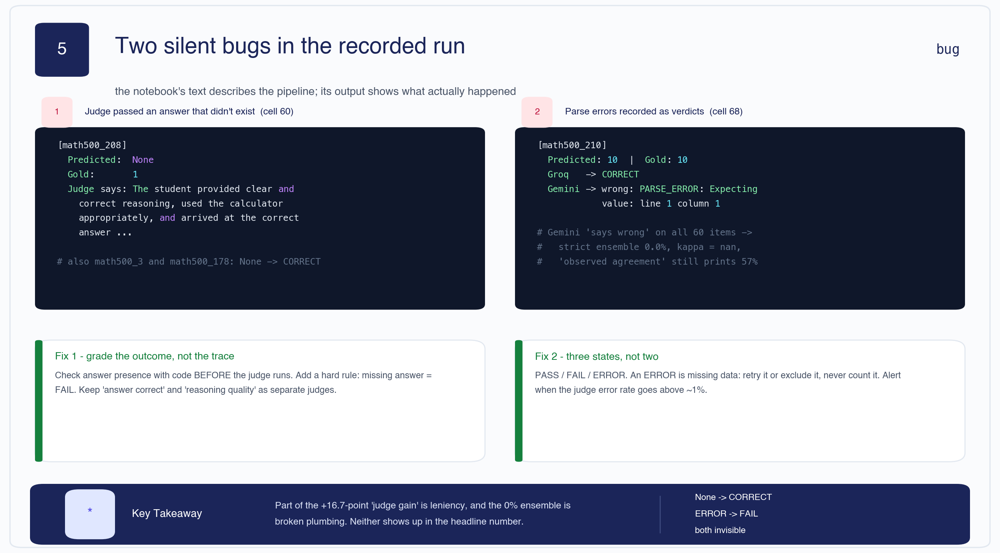

> **⚠ Bug in the run — the judge passed answers that do not exist.**
> Cell 60 lists the cases where the judge disagreed with exact match. Three of them look like this:
>
> ```text
> [math500_208]
>   Predicted: None
>   Gold:      1
>   Judge says: The student provided clear and correct reasoning, used the calculator
>               appropriately, and arrived at the correct answer that there is only 1
>               multiple of 60 in the first 100 positive integers.
> ```
>
> The same thing happens for `math500_3` and `math500_178` — *"arrived at the correct final answer
> of 60"* when the prediction is `None`. The agent never produced an answer. The judge read the
> **trace**, saw plausible-looking work, and narrated a conclusion that was never reached.

That is three of the ten points the judge "gained" over exact match. The judge is not just lenient;
on these rows it is **hallucinating the thing it is supposed to be checking**.

**Fix** — grade the outcome, not the trace. Check answer presence *in code* before the judge runs,
and make missing answer a hard FAIL. If you want to reward good reasoning, that is a **separate
judge with a separate score**, never merged into correctness.

> **⚠ Bug in the run — a judge that never worked was recorded as a judge that disagreed.**
> Cell 68 prints the Groq-vs-Gemini disagreements. Every Gemini verdict reads:
>
> ```text
> Gemini -> wrong: PARSE_ERROR: Expecting value: line 1 column 1 (char 0)
> ```
>
> Gemini's output was never parsed — not on one row, on **all 60**. Those parse failures were
> recorded as the verdict `wrong`.

Three downstream numbers are consequences of that single plumbing failure, not of any judgment:

- **Strict ensemble = 0.0%.** Both judges can never agree "correct" when one of them always says wrong.
- **26/60 "disagreements".** Those are the 26 rows where Groq said correct and Gemini "said" wrong.
- **Groq-vs-Gemini kappa = `nan`.** One rater has no variance, so the statistic is undefined.

**Fix** — three states, not two. `PASS` / `FAIL` / `ERROR`. An `ERROR` is **missing data**: retry
it, or exclude it from the denominator, but never silently count it as a judgment. Alert when the
judge error rate rises above ~1%.

To the notebook's credit, its own kappa cell (cell 66) catches the symptom and says so plainly:

> *"WARNING: kappa is undefined here. This usually means the judges scored every item identically
> (often because the agent produced no valid answers). Fix the upstream pipeline before interpreting
> agreement."*

The warning is right. The scoreboard two cells later still reports the 0.0% strict ensemble as a
result.

> 🧠 **Remember**
> - Same predictions, 0%–43% depending on the ruler.
> - The judge called `None` correct three times, reading the trace instead of the outcome.
> - Every Gemini call failed to parse; the 0% ensemble and the `nan` kappa are plumbing, not judgment.
> - **An error is not a verdict.** PASS / FAIL / ERROR.

[🔝 Back to top](#top)

---

<a id="7"></a>

## 7 · Cohen's kappa, worked

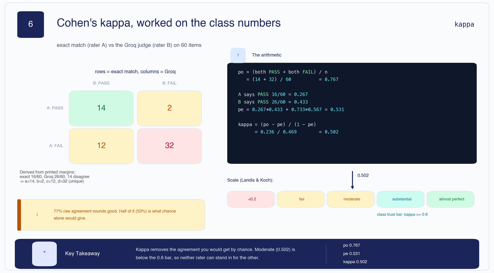

Raw agreement flatters. If two judges both say PASS to almost everything, they will agree most of
the time **by accident**. Kappa subtracts the agreement you would expect from chance.

$$\kappa = \frac{p_o - p_e}{1 - p_e}$$

*In words:* take the agreement you actually observed ($p_o$), subtract the agreement chance alone
would produce ($p_e$), and divide by how much room there was to beat chance.

**Worked on the class numbers.** The notebook prints the margins, not the matrix — but the matrix is
uniquely determined by them. Exact match says correct 16 times, the Groq judge 26 times, and they
disagree on 14 rows:

```text
b = (16 + 14 - 26) / 2 = 2      →  a = 16 - 2 = 14      (both PASS)
c = 14 - 2 = 12                 →  d = 60 - 14 - 2 - 12 = 32   (both FAIL)
```

|  | Groq PASS | Groq FAIL |
|---|---|---|
| **Exact PASS** | 14 | 2 |
| **Exact FAIL** | 12 | 32 |

```text
po = (14 + 32) / 60                       = 0.767
pe = 0.267*0.433 + 0.733*0.567            = 0.531
kappa = (0.767 - 0.531) / (1 - 0.531)     = 0.502
```

**77% raw agreement sounds good. 53% of it is what chance alone would give.** On the Landis–Koch
scale 0.502 is *moderate* — below the 0.6 bar at which you would let one rater stand in for the
other.

### The prevalence paradox

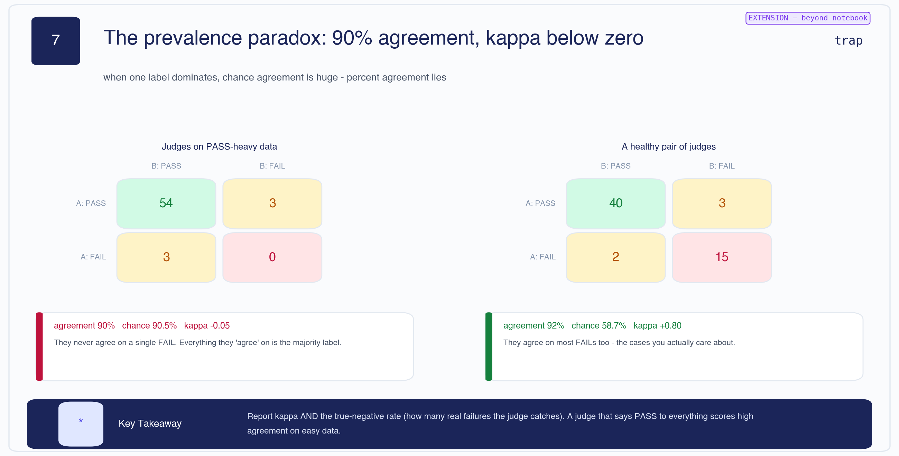

> **⊕ Engineering context** — this is the trap that makes kappa worth knowing.

Take two judges on PASS-heavy data: 54 both-pass, 3 and 3 disagreements, **0 both-fail**.

```text
agreement 90%   chance 90.5%   kappa = -0.05
```

Ninety percent agreement, and kappa **below zero** — worse than chance. They never once agree on a
FAIL, which is the only case anybody cares about. A judge that says PASS to everything scores superb
agreement on easy data and is worthless.

> 🧠 **Mental Model** — **Report kappa AND the true-negative rate.** Percent agreement alone cannot
> tell "both judges are good" from "both judges are lazy and the data is easy".

> 🧠 **Remember**
> - κ = (p<sub>o</sub> − p<sub>e</sub>) / (1 − p<sub>e</sub>). Exact vs Groq: **0.502**, moderate.
> - κ ≥ 0.6 before one rater substitutes for another.
> - High agreement + low κ = prevalence paradox. Quote both, never κ alone.
> - κ = `nan` means a rater had no variance. Fix the pipeline, don't report the number.

[🔝 Back to top](#top)

---

<a id="8"></a>

## 8 · Ensembles, escalation and disagreement

The production pattern the notebook proposes (cell 69) is straightforward:

```text
both judges agree      →  automate: take the verdict
judges disagree        →  escalate: queue for human review
```

Applied to the run (cell 70):

```text
Strict (both agree correct):  0.0%
Lenient (either says correct): 43.3%
Needs human review:           26 / 60 (43.3%)
```

Read naively that says *"43% of your traffic needs a human"* — unaffordable. Read correctly, it says
**one judge was broken**, and the escalation queue is full of plumbing errors rather than genuine
hard cases. That distinction is the difference between redesigning your review process and fixing a
JSON parser.

> **⊕ Engineering context** — before trusting any disagreement rate, sample 20 disagreements and
> categorise them: genuine ambiguity, one judge clearly wrong, or **infrastructure**. Only the first
> bucket justifies human review capacity. A disagreement rate is a composite number, and the
> infrastructure component is usually the largest and the cheapest to remove.

[🔝 Back to top](#top)

---

<a id="9"></a>

## 9 · Traces: whether vs why

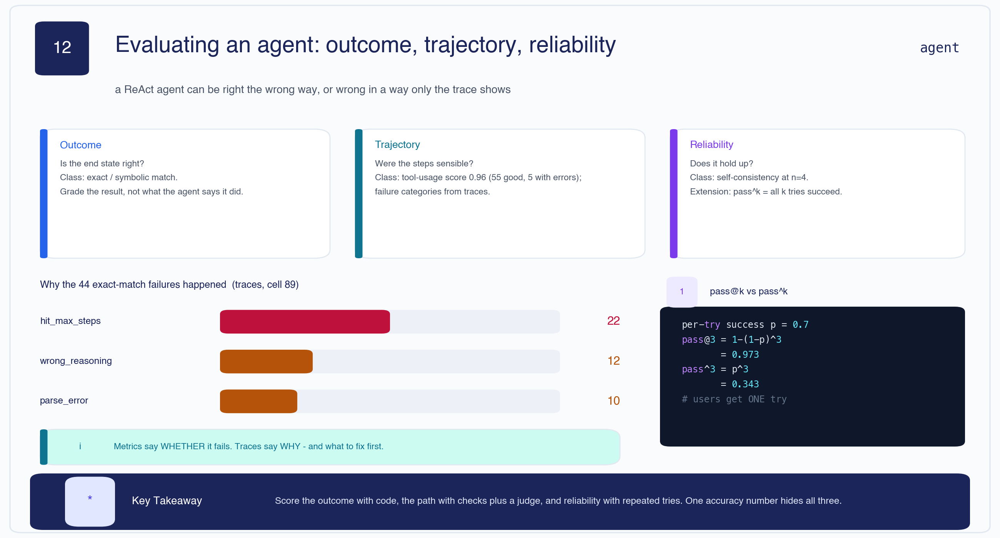

A metric tells you **whether** it failed. A trace tells you **why**. Section 7 instruments the agent
with **Arize Phoenix** (OpenTelemetry) and categorises the failures (cell 89):

| Failure mode | Count |
|---|---|
| `hit_max_steps` | 22 |
| `wrong_reasoning` | 12 |
| `parse_error` | 10 |
| **total** | **44** |

That total reconciles exactly: 44 = 60 − 16 exact-match passes.

**The prioritisation this hands you is unambiguous.** The single largest bucket is not bad maths —
it is the agent looping until the step cap. Half the failures are the harness, not the model's
reasoning. Raising the cap, improving the stop condition, or fixing the output format addresses 32
of 44 failures; better prompting addresses 12.

**Three views of an agent**, and one accuracy number hides all three:

- **Outcome** — is the end state right? (exact / symbolic match)
- **Trajectory** — were the steps sensible? (tool-usage score, failure categories)
- **Reliability** — does it hold up across repeated runs? (self-consistency at n=4)

> **⊕ Engineering context — `pass@k` is not `pass^k`.** With per-try success p = 0.7,
> `pass@3 = 1 − (1−p)³ = 0.973` — the probability that *at least one* of three tries works. But
> `pass^3 = p³ = 0.343` — the probability that *all three* work. Benchmarks love `pass@k`; your user
> gets **one** try. Quote `pass@1` for user-facing reliability, and `pass^k` when consistency matters.

> 🧠 **Remember**
> - 22 max-steps, 12 wrong reasoning, 10 parse errors = 44 = 60 − 16. The arithmetic closes.
> - The biggest failure bucket is the harness, not the maths.
> - Metrics say whether; traces say why and what to fix first.

[🔝 Back to top](#top)

---

<a id="10"></a>

## 10 · DeepEval, CI gates and custom metrics

**DeepEval** (Section 6) wraps judges in a pytest-style API so evaluation can block a merge:

```python
assert_test(test_case, [math_correctness, reasoning_quality])
```

The interesting result is in the summary table, where rows show `MathCorrectness 0.00 (FAIL)`
alongside `ReasoningQuality 0.60 (PASS)` — the agent reasoned well and got the answer wrong. Two
separate metrics capture that; one blended "quality score" would have hidden it. **This is the same
lesson as §6b from the other direction**: keep correctness and reasoning quality apart.

Cell 82 sketches the GitHub Actions integration — run the eval suite on every PR, fail the build on
regression.

**Custom domain metrics** (Section 9) are plain Python. The tool-usage score (cell 92):

```text
Tool usage appropriateness (average): 0.96
  1.0 (good):   55
  0.5 (errors): 5
  0.0 (missed): 0
```

Derivation: (55 × 1.0 + 5 × 0.5) / 60 = 57.5 / 60 = **0.958**.

**Hold that number next to 26.7%.** The agent uses its calculator appropriately 96% of the time and
solves 27% of the problems. Both are true. A custom metric measuring a *behaviour* can look
excellent while the *outcome* fails — which is exactly why it belongs beside the outcome metric and
never instead of it.

> 🧠 **Remember**
> - `assert_test` turns a judge into a CI gate.
> - Keep correctness and reasoning as separate metrics — a blend hides the interesting rows.
> - Tool usage 0.96 vs accuracy 0.267: a behaviour metric is not an outcome metric.

[🔝 Back to top](#top)

---

<a id="11"></a>

## 11 · A judge is a classifier — correct its number

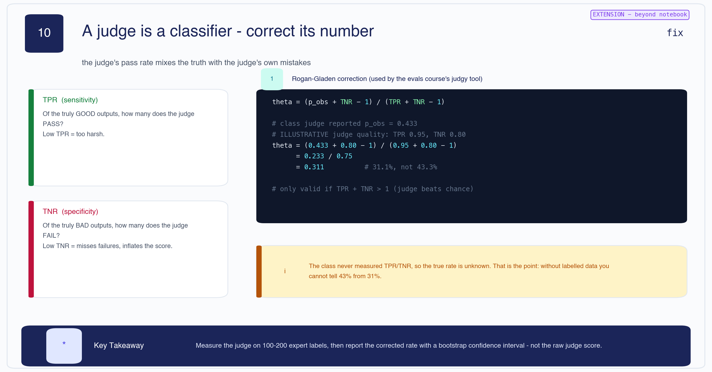

> **⊕ Engineering context** — this entire section is beyond the notebook.

The judge's reported pass rate is not the true pass rate. It is the truth **mixed with the judge's
own mistakes**. Two numbers describe those mistakes:

- **TPR (sensitivity)** — of the truly good outputs, how many does the judge PASS? Low TPR = too harsh.
- **TNR (specificity)** — of the truly bad outputs, how many does the judge FAIL? Low TNR = misses failures and inflates the score.

Given both, invert the contamination with the **Rogan–Gladen** correction:

$$\theta = \frac{p_{obs} + \text{TNR} - 1}{\text{TPR} + \text{TNR} - 1}$$

Worked with the class's reported 43.3% and *illustrative* judge quality (TPR 0.95, TNR 0.80):

```text
theta = (0.433 + 0.80 - 1) / (0.95 + 0.80 - 1)
      = 0.233 / 0.75
      = 0.311        # 31.1%, not 43.3%
```

Valid only when TPR + TNR > 1 — i.e. when the judge beats chance.

**The point is not the 31.1%.** The class never measured TPR or TNR, so the true rate is unknown.
That *is* the point: without labelled data you cannot tell 43% from 31%, and the gap is larger than
most of the improvements anyone reports.

**What to do instead:** label 100–200 outputs by hand, roughly half of which should be genuine
failures, measure the judge against them, then report the corrected rate with a bootstrap confidence
interval.

[🔝 Back to top](#top)

---

<a id="12"></a>

## 12 · Error bars, position bias, and building a judge

> **⊕ Engineering context** — all three subsections are beyond the notebook.

### How sure is "43.3%"?

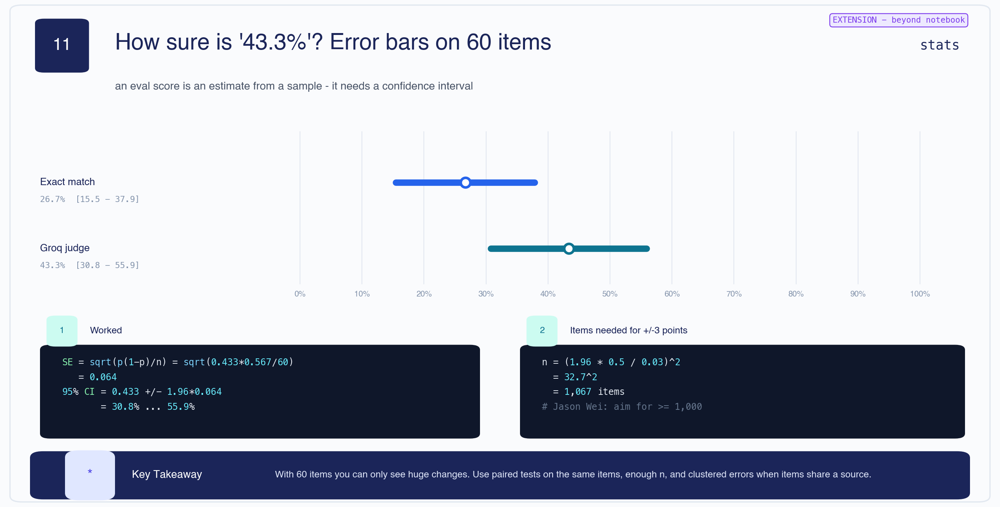

An eval score is an **estimate from a sample**. On 60 items:

```text
SE     = sqrt(p(1-p)/n) = sqrt(0.433 * 0.567 / 60) = 0.064
95% CI = 0.433 +/- 1.96 * 0.064                    = 30.8% ... 55.9%
```

**"43.3%" is really "somewhere between 31% and 56%."** The two bars in the diagram overlap heavily;
on 60 items you can only detect enormous changes.

For ±3 points at p = 0.5:

```text
n = (1.96 * 0.5 / 0.03)^2 = 32.7^2 = 1,067 items
```

Use **paired tests** on the same items (comparing two systems on identical inputs removes
item difficulty as a source of variance), and watch for **clustered errors** when several items
share a source document.

### Position bias

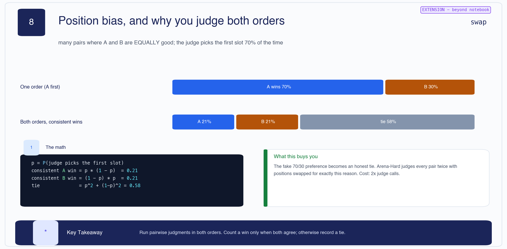

Give a judge two equally good answers and it will still prefer one — often whichever came first. If
the judge picks the first slot with probability p = 0.7:

```text
consistent A win = p * (1-p)        = 0.21
consistent B win = (1-p) * p        = 0.21
tie              = p^2 + (1-p)^2    = 0.58
```

Judging one order reports a confident **70/30 preference**. Judging both orders and counting a win
only when both agree reports **58% ties** — the honest answer. Arena-Hard judges every pair twice
for exactly this reason; the cost is 2× judge calls.

### Building a judge you can trust

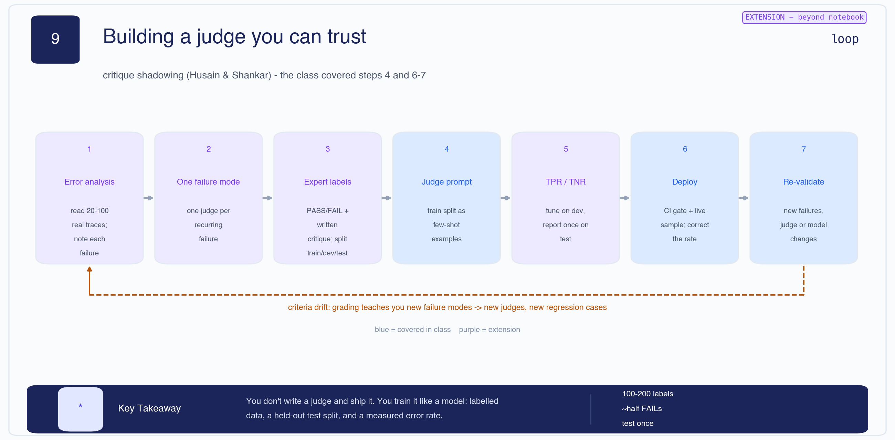

The **critique shadowing** loop (Husain & Shankar). The class covered steps 4 and 6–7; the rest is
what makes a judge trustworthy:

1. **Error analysis** — read 20–100 real traces, note each failure
2. **One failure mode** — one judge per recurring failure, not one judge for "quality"
3. **Expert labels** — PASS/FAIL plus a written critique; split train/dev/test
4. **Judge prompt** — use the train split as few-shot examples
5. **TPR / TNR** — tune on dev, report **once** on test
6. **Deploy** — CI gate plus live sampling; correct the rate
7. **Re-validate** — when new failures appear, or the judge or model changes

And the loop back to step 1: **criteria drift**. Grading teaches you failure modes you did not know
existed, which become new judges and new regression cases.

> 🧠 **Mental Model** — **You don't write a judge and ship it. You train it like a model:** labelled
> data, a held-out test split, and a measured error rate.

[🔝 Back to top](#top)

---

<a id="13"></a>

## 13 · Production eval architecture

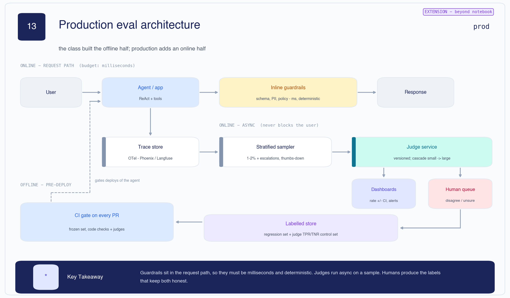

> **⊕ Engineering context** — the class built the offline half; production adds an online half.

Three planes, with different latency budgets:

| Plane | Budget | What runs there |
|---|---|---|
| **Online — request path** | milliseconds | Inline guardrails: schema, PII, policy. Deterministic. |
| **Online — async** | seconds–minutes | Trace store → stratified sampler (1–2% + escalations + thumbs-down) → judge service → dashboards + human queue |
| **Offline — pre-deploy** | minutes | CI gate on every PR: frozen set, code checks + judges |

**Guardrails sit in the request path, so they must be milliseconds and deterministic** — never an
LLM judge. Judges run async on a sample. Humans produce the labels that keep both honest, and those
labels flow into a **labelled store** that serves two purposes: the regression set, and the
TPR/TNR control set from [§11](#11).

The judge service is **versioned** and **cascaded** — a small cheap model handles clear cases, a
large one handles the rest. Treat a judge prompt like a model artifact: version it, and re-validate
whenever it changes.

[🔝 Back to top](#top)

---

<a id="14"></a>

## 14 · Which method, and the one mental model

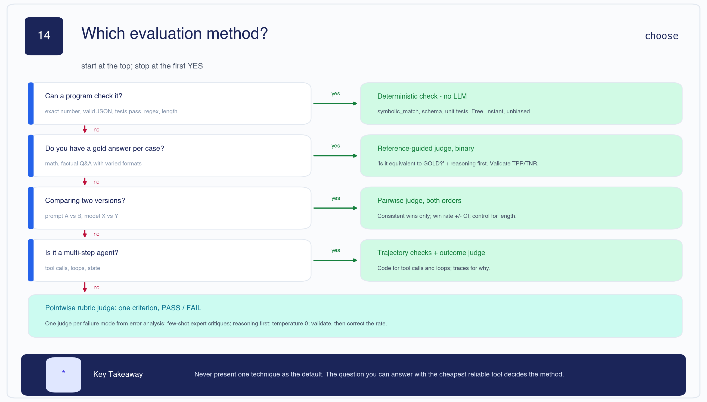

Start at the top; **stop at the first yes**:

| Question | If yes |
|---|---|
| Can a program check it? *(exact number, valid JSON, tests pass, regex, length)* | **Deterministic check — no LLM.** Free, instant, unbiased. |
| Do you have a gold answer per case? *(math, factual Q&A)* | **Reference-guided judge, binary.** "Is it equivalent to GOLD?", reasoning first. Validate TPR/TNR. |
| Comparing two versions? *(prompt A vs B, model X vs Y)* | **Pairwise judge, both orders.** Consistent wins only; win rate ± CI. |
| Is it a multi-step agent? *(tool calls, loops, state)* | **Trajectory checks + outcome judge.** Code for tool calls; traces for why. |
| None of the above | **Pointwise rubric judge:** one criterion, PASS/FAIL, one judge per failure mode, temperature 0 — then validate and correct the rate. |

**Never present one technique as the default.** The question you can answer with the cheapest
reliable tool decides the method.

### The one mental model

> **A judge is a model, so measure it like one.**

Three questions to ask of any evaluation number before you quote it:

1. **Which ruler produced it?** → [§6a](#6) — the same predictions scored 0% to 43%.
2. **Is any of it an artifact?** → [§6b](#6) — `None` passed as correct; parse errors counted as verdicts.
3. **How wide are the error bars?** → [§12](#12) — 43.3% on n=60 is really 31%–56%.

[🔝 Back to top](#top)

---

<a id="interview"></a>

## Interview bank

Twenty-four questions, all answerable from the notes above. 🟠 / 🔴 / 🟣 use the four-line format.

### 🟢 Beginner

**1. What is LLM-as-a-Judge?**
Using an LLM to score another model's output against a rubric, instead of comparing strings. It
takes the question, the answer, a rubric and optionally a gold answer, and returns reasoning
followed by a verdict.

**2. Why not just use exact string match?**
It cannot see equivalence (`0.5` vs `1/2`) and it cannot judge reasoning at all. It is still the
right first metric because it is free, instant and unbiased — just not sufficient.

**3. Why should a judge output reasoning before the verdict?**
Verdict-first produces post-hoc rationalisation: the model commits, then justifies. Reasoning-first
makes the justification part of the decision, and gives you something to read when you audit it.

**4. What are the three views of an agent's behaviour?**
Outcome (is the end state right), trajectory (were the steps sensible), and reliability (does it
hold up across repeated runs). A single accuracy number hides all three.

**5. What does the 5-example fallacy mean?**
Testing on a handful of prompts you chose yourself. It gives selection bias, no way to detect silent
drift, and no regression signal when a change breaks something.

### 🔵 Intermediate

**6. Symbolic matching scored exactly the same as exact match. What does that tell you?**
That formatting was never the bottleneck. The same cell shows only 28 of 60 runs produced an answer
at all — 22 hit max steps, 10 failed to parse. Equivalence-aware comparison has nothing to compare
when a third of predictions are `None`.

**7. What is Cohen's kappa and why not use percent agreement?**
κ = (p<sub>o</sub> − p<sub>e</sub>)/(1 − p<sub>e</sub>) — observed agreement minus chance agreement,
normalised. Percent agreement flatters: two judges that both pass everything agree constantly by
accident. On the class numbers 77% raw agreement is κ = 0.502, because 53% was chance.

**8. What does a kappa of `nan` mean?**
A rater had no variance — it gave every item the same label, so chance agreement is 1 and the
denominator collapses. It is a signal to fix the pipeline, not a number to report.

**9. The tool-usage score was 0.96 while accuracy was 26.7%. Is the metric wrong?**
No — they measure different things. 0.96 says the agent used its calculator appropriately; 26.7%
says it got the answer right. A behaviour metric can look excellent while the outcome fails, which
is why it belongs beside the outcome metric, never instead of it.

**10. What is the difference between `pass@k` and `pass^k`?**
`pass@k = 1 − (1−p)^k` is the chance at least one of k tries works; `pass^k = p^k` is the chance all
k work. At p = 0.7 and k = 3 that is 0.973 versus 0.343. Benchmarks quote `pass@k`; your user gets
one try.

**11. Why run a pairwise judge in both orders?**
Position bias. If the judge picks the first slot 70% of the time on equally good answers, a
single-order run reports a confident 70/30 preference. Judging both orders and counting only
consistent wins gives 21/21/58 — mostly ties, which is the truth.

### 🟠 Advanced

**12. The judge rated three predictions correct when the prediction was `None`. What happened, and what do you change?**

- *What the interviewer is testing:* whether you read judge outputs or just their aggregate.
- *Expected reasoning:* identify what the judge was actually shown and what it was asked to score.
- *Strong answer:* The judge saw the full trace, not just the final answer. It read plausible-looking intermediate work and narrated a conclusion — *"arrived at the correct final answer of 60"* — that the agent never reached. Those three rows are three of the ten points the judge "gained" over exact match. The fix is to grade the outcome, not the trace: check answer presence in code before the judge runs and make a missing answer a hard FAIL, then score reasoning quality as a separate metric that never merges into correctness.

**13. Every Gemini verdict was a parse error. Which reported numbers are invalid as a result?**

- *What the interviewer is testing:* whether you can trace one infrastructure fault through to the metrics it corrupts.
- *Expected reasoning:* find every downstream number that depends on the second judge.
- *Strong answer:* Three. The strict ensemble of 0.0% — both judges can never agree "correct" when one always says wrong. The 26/60 disagreement rate — those are just the rows Groq passed. And the Groq-vs-Gemini kappa of `nan` — one rater had no variance. None of the three is a judgment; all are a JSON parser. The fix is three states: PASS, FAIL and ERROR, where an ERROR is missing data to be retried or excluded, never counted as a verdict, with an alert above ~1% error rate.

**14. Two judges agree 90% of the time and kappa is −0.05. Explain, and say what you would report.**

- *What the interviewer is testing:* understanding that agreement statistics depend on base rates.
- *Expected reasoning:* work out where the agreement is concentrated.
- *Strong answer:* The prevalence paradox. With 54 both-pass, 3 and 3 disagreements and zero both-fail, chance agreement alone is 90.5%, so kappa goes slightly negative. The judges never once agree on a FAIL — the only case anyone cares about. I would report kappa alongside the true-negative rate and the raw confusion matrix, because percent agreement cannot distinguish "both judges are good" from "both judges are lazy and the data is easy".

**15. Derive the confusion matrix from the printed margins and compute kappa.**

- *What the interviewer is testing:* comfort with the arithmetic rather than a library call.
- *Expected reasoning:* recognise the margins determine the matrix uniquely.
- *Strong answer:* Exact says correct 16, Groq says 26, and they disagree on 14. So b = (16+14−26)/2 = 2, c = 12, a = 14, d = 32. Then p<sub>o</sub> = (14+32)/60 = 0.767; p<sub>e</sub> = 0.267×0.433 + 0.733×0.567 = 0.531; κ = 0.236/0.469 = 0.502. Moderate — below the 0.6 bar, so neither rater can stand in for the other.

**16. "Our agent scores 43.3%." What is wrong with that sentence?**

- *What the interviewer is testing:* whether you treat a score as a measurement with properties.
- *Expected reasoning:* name what is missing, with numbers.
- *Strong answer:* Three things. It omits the ruler — the same 60 predictions score 26.7% by exact match, 43.3% by judge, 0% by strict ensemble. It omits the judge's error rate — with TPR 0.95 and TNR 0.80 the Rogan–Gladen correction puts the true rate nearer 31%. And it omits the error bars — on n=60 the 95% CI is 30.8% to 55.9%. A score is a property of the measurement as much as of the model.

**17. The biggest failure bucket was `hit_max_steps` (22 of 44). What do you do first?**

- *What the interviewer is testing:* whether you let error analysis set priorities.
- *Expected reasoning:* separate harness failures from reasoning failures.
- *Strong answer:* Not prompt engineering. 22 max-steps plus 10 parse errors is 32 of 44 failures in the harness, versus 12 that are genuinely wrong reasoning. I would check whether the step cap is too low or the stop condition is not firing, and fix the output format that causes parse errors. That addresses nearly three-quarters of the failures. Improving the model's maths addresses the remaining 12 — and until the first 32 are fixed, I cannot even measure that improvement cleanly.

### 🔴 Senior

**18. Design an evaluation harness so the two bugs in this run cannot recur.**

- *What the interviewer is testing:* whether you build systems that surface their own faults; correctness instincts under partial failure.
- *Expected reasoning:* separate data problems from judgment problems, and make preconditions explicit.
- *Strong answer:* Four rules. **Preconditions in code**: answer presence, schema validity and length are checked before any judge runs, and a missing answer is a hard FAIL the judge never sees. **Three states**: PASS / FAIL / ERROR, with ERROR excluded from the denominator and reported separately; the run aborts if the error rate crosses a threshold. **Separate metrics**: correctness and reasoning quality are never blended. **Invariants on the aggregate**: assert kappa is defined, assert each rater has variance, assert the denominators match across compared runs. A weak answer adds retries and still reports one percentage.

**19. You have 200 engineers shipping LLM features. How do you make evaluation a shared capability?**

- *What the interviewer is testing:* platform thinking; understanding that a metric is a specification.
- *Expected reasoning:* centralise what must be comparable, decentralise what must be domain-specific.
- *Strong answer:* Centralise the judge service (versioned prompts, cascaded models, TPR/TNR tracked per version), the labelled store, and the statistics — CI computation, paired tests, the kappa checks. Decentralise the golden sets and the domain rubrics, because only the team knows what good looks like. Make the labelled store the hub: it is simultaneously the regression set and the control set for judge quality. Enforce two things in review — a judge prompt change is a versioned artifact requiring re-validation, and no dashboard renders a score without its n and CI. The hard part is organisational: a metric is a specification, so metric review needs the rigour of API review.

**20. Your judge's pass rate climbed 5 points after a model upgrade. How do you tell improvement from drift?**

- *What the interviewer is testing:* whether you can isolate a change in the measured from a change in the measurer.
- *Expected reasoning:* the judge and the system both changed; hold one fixed.
- *Strong answer:* Re-run the **old** judge version against the **new** outputs, and the **new** judge against a frozen set of old outputs. If the new judge scores old outputs higher, the judge got more lenient and the gain is drift. Then re-measure TPR/TNR on the labelled control set — if TNR dropped, the judge is missing failures and the headline rate is inflated. Five points is also within the noise on a small set, so check the CI before treating it as real at all. This is why judge prompts are versioned artifacts and why the control set exists.

**21. When is LLM-as-a-Judge the wrong tool?**

- *What the interviewer is testing:* knowing the boundary of a technique you were just taught.
- *Expected reasoning:* identify what the technique assumes.
- *Strong answer:* When a program can check it — exact numbers, valid JSON, passing tests, regex, length — a deterministic check is free, instant and unbiased, and you should never pay an LLM for it. When the judge sits in the request path, because judges are seconds and guardrails must be milliseconds. When you have no labelled data, because an unvalidated judge is a number nobody has checked. And when the criterion is genuinely subjective and high-stakes, where the honest answer is human review, not an LLM with a confident rubric.

### 🟣 Staff / System design

**22. Design the eval architecture for a customer-facing agent at scale.**

- *What the interviewer is testing:* system design across latency budgets; knowing what can and cannot block a user.
- *Expected reasoning:* separate the planes by budget first, then connect them with a feedback loop.
- *Strong answer:* Three planes. The **request path** carries only deterministic guardrails — schema, PII, policy — measured in milliseconds; no LLM judge ever blocks a user. The **async plane** writes every interaction to a trace store over OpenTelemetry, then a stratified sampler takes 1–2% plus all escalations and thumbs-down into a versioned, cascaded judge service feeding dashboards and a human queue. The **offline plane** gates every PR against a frozen regression set. The loop that makes it work: human labels flow into a labelled store serving double duty as the regression set and the TPR/TNR control set, so judge quality is continuously measured rather than assumed. Alerting is on rate-with-CI, not raw rate, so you are not paged by sampling noise.

**23. Your eval score is flat for three months while users complain more. Where do you look?**

- *What the interviewer is testing:* understanding that a golden set is a fixed sample of a moving distribution.
- *Expected reasoning:* suspect the measurement before concluding the users are wrong.
- *Strong answer:* The golden set has gone stale — it samples the traffic distribution of three months ago, and real usage has moved. I would compare the live input distribution against the golden set along the dimensions that matter (intent, length, language, source), then sample recent thumbs-down and failures into a new slice and re-measure. Second, check for criteria drift: the judge rubric encodes what mattered when it was written, and new failure modes have no judge watching them. Third, check per-slice rather than aggregate — a flat average routinely hides one segment collapsing while another improves. The golden set is a living artifact; a score that never moves is usually a measurement that stopped looking.

**24. Make the case against building any of this for a small team.**

- *What the interviewer is testing:* judgement about cost, and willingness to argue against the lecture.
- *Expected reasoning:* weigh the honest cost of the full pyramid against its benefit at small scale.
- *Strong answer:* The full stack is expensive: labelled data, a judge service, human review capacity, and a labelled store nobody wants to own. For a small team the first 80% of the value is in the bottom two layers — a frozen golden set and deterministic checks in CI. Those cost almost nothing and catch regressions, which is the main risk. I would add a judge only for the one criterion code genuinely cannot express, validate it on 100 hand-labelled examples, and stop there. What I would not skip is error bars and reading the raw outputs: this very notebook shows that the expensive half of the pyramid produced three fabricated passes and a broken ensemble, while the cheap half — exact match plus reading the trace counts — was correct and informative throughout.

[🔝 Back to top](#top)

---

<a id="recall"></a>

## Explain It Yourself

Cover the notes. Say each answer out loud. If you stall, the section is linked.

1. Explain why five examples are not an evaluation, naming all three failure modes. → [§1](#1)
2. Walk up the evaluation pyramid and say what changes at each level. → [§2](#2)
3. Explain why symbolic matching gained exactly 0.0 points here. → [§4](#4)
4. State all five accuracy numbers from the run and say which you would quote. → [§6a](#6)
5. Describe both bugs in the recorded run and the fix for each. → [§6b](#6)
6. Derive kappa from the printed margins without looking. → [§7](#7)
7. Explain the prevalence paradox using the 54/3/3/0 matrix. → [§7](#7)
8. Given 43.3% on n=60, state the confidence interval and what n you would need for ±3 points. → [§12](#12)

[🔝 Back to top](#top)

---

## One-Page Revision

### Core

| | |
|---|---|
| **LLM-as-a-Judge** | an LLM scoring output against a rubric. Reasoning first, verdict second, temperature 0, JSON out. |
| **Golden dataset** | fixed, stratified, version-controlled. Here 60 = 50 MATH-500 + 10 stress tests. |
| **Cohen's kappa** | agreement corrected for chance. κ ≥ 0.6 before one rater substitutes for another. |
| **Ensemble + escalation** | judges agree → automate; judges disagree → human review. |
| **Evaluation pyramid** | code at the base, judges in the middle, humans at the top. Push checks down. |

### The numbers

| Number | Meaning |
|---|---|
| **26.7%** | exact match **and** symbolic match, 16/60 — the upgrade gained **+0.0** |
| **43.3%** | Groq judge, 26/60 — **+16.7** over exact match |
| **0.0% / 43.3%** | strict / lenient ensemble — the 0% is a parse bug, not a judgment |
| **28 / 22 / 10** | final answer / max steps / parse error — only 28 of 60 produced an answer |
| **22 / 12 / 10** | failure modes = 44 = 60 − 16. The harness, not the maths, dominates |
| **14 / 2 / 12 / 32** | exact-vs-Groq confusion matrix → p<sub>o</sub> 0.767, p<sub>e</sub> 0.531, **κ 0.502** |
| **nan** | Groq-vs-Gemini kappa — one rater had no variance |
| **0.96** | tool-usage score, against 26.7% accuracy — behaviour ≠ outcome |
| **30.8–55.9%** | the real 95% CI behind "43.3%" on n=60 |
| **1,067** | items needed for ±3 points at p = 0.5 |
| **31.1%** | Rogan–Gladen corrected rate at illustrative TPR 0.95 / TNR 0.80 |
| **0.58** | tie rate once you judge both orders at p = 0.7 position bias |

### Formulas

```text
kappa  = (po - pe) / (1 - pe)
SE     = sqrt(p(1-p)/n)          95% CI = p +/- 1.96*SE
n      = (1.96 * 0.5 / margin)^2
theta  = (p_obs + TNR - 1) / (TPR + TNR - 1)      # valid iff TPR + TNR > 1
pass@k = 1 - (1-p)^k             pass^k = p^k
```

### Failure modes seen in this notebook

1. **Judge passed non-existent answers** — `Predicted: None` rated correct, three times.
2. **Errors recorded as verdicts** — all 60 Gemini calls failed to parse, counted as "wrong".
3. **Derived metrics inherited the bug** — 0% strict ensemble, 26/60 "disagreements", κ = nan.
4. **A metric upgrade that changed nothing** — symbolic match, +0.0 points.
5. **Behaviour metric flattering a failing system** — tool usage 0.96 against 26.7% accuracy.
6. **No error bars** — 43.3% on n=60 is 31%–56%.
7. **Judge quality never measured** — no TPR/TNR, so the true rate is unknown.

### The rule

> **A judge is a model, so measure it like one.**
> Which ruler produced the number? Is any of it an artifact? How wide are the error bars?

[🔝 Back to top](#top)

---

## Companion files

- Notebook — [`L14_LLM-as-a-Judge & Advanced Evaluation.ipynb`](./L14_LLM-as-a-Judge%20%26%20Advanced%20Evaluation.ipynb)
- Results verification — [`scripts/verify_llm_judge_results.py`](../../scripts/verify_llm_judge_results.py)
- Diagram source — [`scripts/_build_l15_judge_diagrams.py`](../../scripts/_build_l15_judge_diagrams.py)
- Previous lecture — [L14 · DSPy: Mathematical Prompt Optimization](../14.%20DSPy:%20Mathematical%20Prompt%20Optimization/L14_DSPy_Mathematical_Prompt_Optimization.md)
- Recipe these notes follow — [`.claude/VISUAL_STUDY_NOTES.md`](../../.claude/VISUAL_STUDY_NOTES.md)

[🔝 Back to top](#top)
